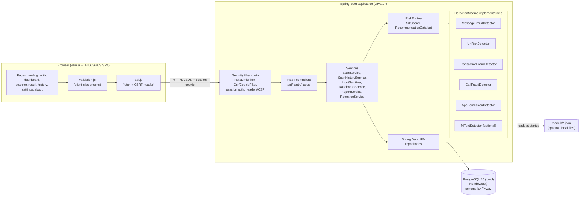

# Architecture

UniversalShield is a single Spring Boot application (a "modular monolith") that serves both a
JSON REST API and a static vanilla-JavaScript single-page frontend. One deployable jar, one
database. This keeps it easy to run on a student laptop and easy to explain in a viva, while
the internal packages are separated so pieces could later be split out.

## 1. High-level diagram

(Source: [diagrams/architecture.mmd](diagrams/architecture.mmd).)

## 2. Layers and packages

| Layer | Package(s) | Responsibility | Depends on |
|---|---|---|---|
| Frontend | `src/main/resources/static` | Pages, client-side validation, rendering results and charts from API data | REST API only |
| Security | `security` | Session authentication, CSRF cookie, rate limiting, security headers, CORS, subject hashing | Spring Security |
| Web / API | `api`, `auth`, `user`, `dto`, `exception` | HTTP mapping, request validation, DTOs, uniform JSON errors | services |
| Application services | `service`, `reporting` | Orchestrating scans, history lookups, sanitising, dashboard aggregation, reports, retention | engine, repositories |
| Detection engine | `engine`, `engine.input` | Domain model (FraudEvent, DetectorResult, FraudResult, Indicator...), RiskScorer, RiskEngine, recommendations | nothing Spring-specific |
| Detectors | `detectors.*`, `ml` | One `DetectionModule` per fraud category, plus the optional trained text classifier | engine |
| Persistence | `domain`, `repository`, `db/migration` | JPA entities, Spring Data repositories, Flyway SQL schema | database |
| Configuration | `config` | Typed properties, engine wiring, OpenAPI, demo seed, production safety check | all |

Rule of thumb: arrows only point downwards. The `engine` package has no Spring annotations,
so the scoring logic can be unit-tested with plain `new` calls (see `RiskEngineTest`).

## 3. Main components

- **DetectionModule** (`engine/DetectionModule.java`): the extension interface. Each detector
  declares `id()`, `version()`, `categories()`, `sourceType()`, `available()`,
  `appliesTo(event)` and `analyze(event)` returning a `DetectorResult`.
- **Five heuristic detectors**: message, URL, transaction, call and app-permission. They only
  look at what the user typed. None of them makes network calls (the URL detector never
  fetches the URL).
- **TextSignals** (`detectors/common`): shared catalogue of 16 social-engineering phrases
  (OTP request, urgency, threats, remote-access requests...) with negation handling, reused by
  the message, call and transaction detectors so one tactic is described and weighted once.
- **Reputation providers** (`DomainReputationProvider`, `PhoneReputationProvider`): interfaces
  with "not configured" default implementations. They exist so a verified external source can be
  plugged in later; today they always return `NOT_CONFIGURED`, and the UI says so.
- **MlTextDetector** (`ml`): optional Naive Bayes classifier for messages and URLs. It is
  `available()` only if a model file exists in `models/`. See [ML.md](ML.md).
- **RiskEngine** (`engine/RiskEngine.java`): runs every available detector that applies,
  merges indicators, calls `RiskScorer`, caps the score, maps it to a `RiskLevel`, computes
  `EvidenceStrength`, picks recommendations and attaches disclaimers. See [SCORING.md](SCORING.md).
- **ScanService**: the use-case orchestrator: validates the request shape, hashes the subject,
  loads `ScanHistory`, calls the engine, sanitises the excerpt and saves the scan in one
  transaction.
- **ReportService**: renders a stored scan as JSON or as a printable, HTML-escaped report.
- **RetentionService**: a scheduled job (03:30 daily) that deletes scans older than each user's
  retention setting.

## 4. Request lifecycle (short version)

Browser form → `validation.js` → `api.js` (adds `X-XSRF-TOKEN`) → filters (rate limit, CSRF,
session) → controller (`@Valid`) → `ScanService` → `RiskEngine` → detectors → `RiskScorer` →
repository → database → `ScanResponse` JSON → result page. The full version with diagrams is in
[REQUEST_FLOW.md](REQUEST_FLOW.md).

## 5. Profiles

| Profile | Database | Extras | Use |
|---|---|---|---|
| `dev` (default) | H2 file `./data/devdb` | demo account + 7 synthetic demo scans, API docs public | local development and classroom demo |
| `test` | H2 in memory | ML off, rate limit off | automated tests |
| `prod` | PostgreSQL from `DB_URL` | `ProductionSafetyCheck` refuses weak `APP_HASH_SECRET`; API docs private by default; secure cookies | Docker / cloud |

Flyway owns the schema in every profile and Hibernate only validates it (`ddl-auto: validate`),
so the same SQL migration is exercised in tests, dev and production.

## 6. Extension points

1. **Add a detector**: implement `DetectionModule`, annotate it with `@Component`, give it a
   unique `id()` and a `version()`. `EngineConfig` collects all modules automatically and
   `DetectorCatalogService` records it in `detector_metadata` at startup. Put its indicators in
   new or existing correlation groups (see SCORING.md section 3).
2. **Add a fraud category**: add a value to `ScanCategory`, an input record in `engine/input`,
   a field in `ScanRequest`, a factory in `FraudEvent`, a case in `ScanService.toEvent`/`subject`,
   update the CHECK constraints with a new Flyway migration (`V2__...sql`) and add a form in
   `pages/scanner.js`.
3. **Plug in reputation data**: implement `DomainReputationProvider` or
   `PhoneReputationProvider` as a `@Primary` bean. Indicators from a verified source must use
   `ResultSource.VERIFIED_EXTERNAL`; only then is the 95-point cap lifted.
4. **Swap the ML model**: any class that produces `p(fraud)` can replace `NaiveBayesModel`
   behind `MlModelService`, as long as metadata and evaluation are written the same way.

## 7. Key design decisions

| Decision | Why | Trade-off |
|---|---|---|
| Rule-based detectors first, ML optional | Explainable, works offline, no training data needed, honest about what it knows | Weights are expert guesses, not calibrated |
| Noisy-OR over correlation groups | Bounded 0-100, no double counting, diminishing returns | Assumes groups are independent, which is only approximately true |
| Score separate from evidence strength | A high score from one strong sign differs from a high score from five signs; users should see both | Two numbers to explain |
| Session cookie + CSRF, not JWT | Simplest secure option for a same-origin SPA; logout really ends the session | Needs sticky sessions or a shared session store to scale horizontally |
| Monolith with packages | One jar, easy to deploy and grade | Detectors cannot be scaled independently |
| Vanilla JS, no build step | Required by the brief; nothing to install besides the JDK | More manual DOM code; all rendering uses `textContent` to avoid XSS |
| Flyway + `validate` | Schema is versioned, reviewable SQL; Hibernate cannot silently change it | Schema changes need a migration file |
| Hash the "subject" (recipient, domain, number) | History features work without storing raw identifiers | Hashes are per-deployment; changing `APP_HASH_SECRET` breaks the link to old scans |
| In-memory rate limiter | No Redis dependency | Limits are per instance and reset on restart |
