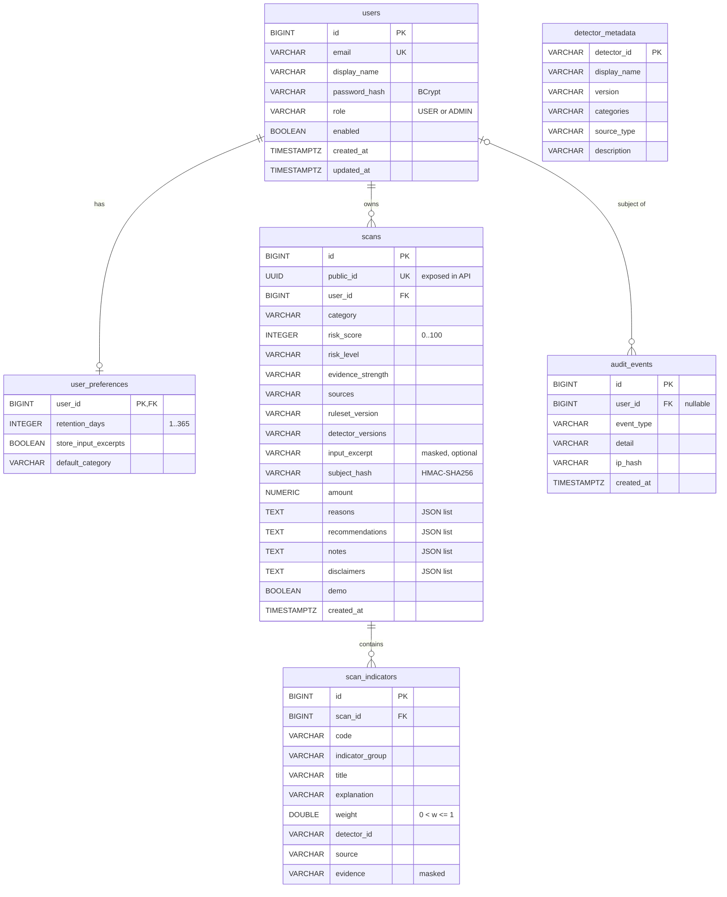

# Database

The schema is defined once, in SQL, by Flyway:
[`src/main/resources/db/migration/V1__initial_schema.sql`](../src/main/resources/db/migration/V1__initial_schema.sql).
Hibernate runs with `ddl-auto: validate`, so it checks the entities against this schema at
startup and refuses to start if they differ. It never creates or changes tables itself.

The same SQL runs on **PostgreSQL 13+** (production, verified on PostgreSQL 16) and on **H2**
in PostgreSQL compatibility mode (dev and tests).

## 1. ER diagram

(Source: [diagrams/er-diagram.mmd](diagrams/er-diagram.mmd).)

## 2. Tables

| Table | Purpose | Key points |
|---|---|---|
| `users` | Accounts | `email` unique; `password_hash` is a BCrypt hash (Spring DelegatingPasswordEncoder, `{bcrypt}` prefix); `role` limited to USER/ADMIN by a CHECK |
| `user_preferences` | Privacy settings per user (1:1) | `retention_days` 1-365 (default 90); `store_input_excerpts`; `default_category`. Deleted with the user |
| `scans` | One row per stored scan result | `public_id` UUID is the only id the API exposes; score CHECK 0-100; level/evidence/category CHECKs; JSON lists stored as TEXT; `demo` flag; deleted with the user |
| `scan_indicators` | The matched indicators of a scan (1:N) | weight CHECK `0 < w <= 1`; source CHECK; deleted with the scan |
| `detector_metadata` | Catalogue of detectors and versions | Upserted at startup by `DetectorCatalogService` |
| `audit_events` | Security-relevant events (`USER_REGISTERED`, `LOGIN_SUCCESS`, `LOGIN_FAILURE`, `HISTORY_DELETED`, `ACCOUNT_DELETED`) | `ip_hash` is an HMAC of the client IP, never the IP itself; `user_id` becomes NULL when the user is deleted |

### Why some columns are TEXT holding JSON

`reasons`, `recommendations`, `notes` and `disclaimers` are always read and written together
with their scan and are never queried individually. Storing them as JSON text (via
`StringListConverter` and `RecommendationListConverter`) keeps the schema portable between H2
and PostgreSQL. Indicators **are** queried (history search matches indicator titles), so they
get their own table.

### Constraints and indexes

- Foreign keys: `user_preferences.user_id`, `scans.user_id` and `scan_indicators.scan_id` use
  `ON DELETE CASCADE`; `audit_events.user_id` uses `ON DELETE SET NULL`.
- Unique: `users.email`, `scans.public_id`.
- Indexes follow the queries: `(user_id, created_at)` for history and retention,
  `(user_id, category)`, `(user_id, risk_level)` for filters, `(user_id, subject_hash)` for
  "seen this recipient/domain before", `scans(created_at)` for the retention job,
  `scan_indicators(scan_id)`, and two indexes on `audit_events`.

## 3. What is stored, and what is not

| Stored | Not stored |
|---|---|
| Score, level, evidence, indicators, recommendations, versions | Passwords in clear text (BCrypt only) |
| A **masked** excerpt of the input (≤ 500 characters), if the user allows it | OTPs, card numbers, long digit runs: masked by `InputSanitizer` before saving |
| `subject_hash`: HMAC-SHA256 of the recipient, domain, phone number or sender | The raw recipient, domain or number as a separate column |
| Amount of a transaction scan (used for the "unusual amount" comparison) | Uploaded permission files (parsed in memory, then discarded) |

The excerpt and indicator evidence can still contain personal text the user typed. That is why
users can switch excerpts off, delete single scans, delete all history, or delete the account.

## 4. Retention

`RetentionService` runs daily at 03:30 server time (`universalshield.retention.cron`). For each
user it deletes scans older than that user's `retention_days`. It also deletes audit events
older than 365 days. Indicators go with their scans through the cascade.

## 5. Demo seed data

In the **dev profile only**, `DemoDataSeeder` creates the account
`demo@universalshield.local` (password from `DEMO_PASSWORD`, default `ShieldDemo2026`) with 7
example scans, one or more per category. They are produced by running the real engine on
synthetic inputs, and each is stored with `demo = true` and labelled "Demo" in the UI and API.
They are not real cases. The seeder does nothing if the demo user already exists, and it never
runs in the `test` or `prod` profiles.

## 6. Migrations

- Never edit `V1__initial_schema.sql` after it has run on a real database. Add `V2__...sql`,
  `V3__...sql`. Flyway records applied versions in `flyway_schema_history` and checks checksums.
- Migrations run automatically at startup.
- Backups for PostgreSQL: see [DEPLOYMENT.md](DEPLOYMENT.md#10-backups).

## 7. Inspecting the dev database

The dev H2 database is the file `data/devdb.mv.db`. Stop the app before opening it with
another tool, because H2 file databases allow only one process at a time. To start fresh, stop
the app and delete `data/devdb.*`; the schema and demo data are recreated at the next start.
