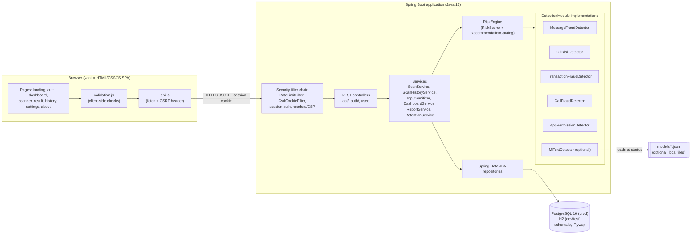
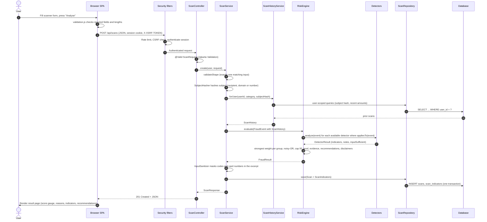

# Request flow: what happens when you press "Analyze"

This document follows one scan from the user's click to the rendered result, naming the exact
file and method at each step. Use it with the code open side by side.

## 1. Architecture flowchart

## 2. Sequence diagram of `POST /api/scans`

(Sources: [diagrams/architecture.mmd](diagrams/architecture.mmd),
[diagrams/scan-sequence.mmd](diagrams/scan-sequence.mmd).)

## 3. Step by step

| # | Where | What happens |
|---|---|---|
| 1 | `static/js/pages/scanner.js` → submit handler | The form values are read with `readValues` for the chosen category. |
| 2 | `static/js/validation.js` → `validateScan` | Required fields, lengths, URL shape, amount and number format are checked. Errors are shown next to each field and nothing is sent. This is only a convenience; the server checks everything again. |
| 3 | `scanner.js` → `buildPayload` | Builds `{"category":"MESSAGE","message":{...}}`. Only the input object for that category is included. |
| 4 | `static/js/api.js` → `request` | For any non-GET request it makes sure the `XSRF-TOKEN` cookie exists (`GET /api/auth/csrf` if needed) and copies it into the `X-XSRF-TOKEN` header. The browser sends the `JSESSIONID` session cookie automatically (same origin, `HttpOnly`, `SameSite=Lax`). |
| 5 | `security/RateLimitFilter` | Counts requests per client per minute (default 30 scans, 10 auth attempts). Over the limit returns `429 RATE_LIMITED`. |
| 6 | Spring Security `CsrfFilter` (configured in `security/SecurityConfig`) | Compares header and cookie. A mismatch returns `403 CSRF_INVALID` as JSON; `api.js` then refreshes the token. |
| 7 | Spring Security session authentication | The session must hold an authenticated `AppUserPrincipal`. Otherwise `401 UNAUTHORIZED` (JSON, never a redirect). |
| 8 | `api/ScanController.create` | `@Valid @RequestBody ScanRequest` triggers Jakarta Validation on the nested input record (e.g. message text max 5000 chars). Failures go to `exception/GlobalExceptionHandler` and return `400 VALIDATION_FAILED` with a per-field list. Rejected values are never echoed back. |
| 9 | `service/ScanService.create` | `validateShape` makes sure the input object matching `category` is present. `subject()` extracts the thing being judged (recipient, domain, phone number, sender) and `security/SubjectHasher` turns it into an HMAC-SHA256 hash. |
| 10 | `service/ScanHistoryService.forUser` | Runs user-scoped queries (`ScanRepository`, always `WHERE user_id = ?`) to build `ScanHistory`: previous transaction amounts, how often this subject was scanned, and whether it was rated HIGH/CRITICAL before. |
| 11 | `ScanService.toEvent` | Wraps input and history into an immutable `engine/FraudEvent`. |
| 12 | `engine/RiskEngine.evaluate` | Calls `analyze(event)` on every detector where `available()` and `appliesTo(event)` are true. A message scan runs `MessageFraudDetector`, plus `MlTextDetector` only if a trained message model exists. |
| 13 | Detector, e.g. `detectors/message/MessageFraudDetector.analyze` | Matches `TextSignals`, checks sender/body mismatch etc., and returns a `DetectorResult` (indicators with code, group, weight and masked evidence; notes; `inputSufficient`). |
| 14 | `engine/RiskScorer` | Keeps the strongest weight per indicator group, combines groups with noisy-OR, rounds to 0-100, and computes `EvidenceStrength`. |
| 15 | `RiskEngine` (continued) | Caps the score at 95 unless a `VERIFIED_EXTERNAL` source took part, maps it to `RiskLevel` using the configured thresholds, writes human-readable reasons, asks `RecommendationCatalog` for at most 6 recommendations, and adds disclaimers. Returns a `FraudResult`. |
| 16 | `ScanService` (continued) | `InputSanitizer` masks OTP-like codes, card numbers (Luhn-checked) and long digit runs in the excerpt. If the user turned off "store input excerpts" in Settings, no excerpt is saved. |
| 17 | `ScanRepository.save` | Inserts one row in `scans` and one row per indicator in `scan_indicators` (cascade) inside one transaction. |
| 18 | `service/ScanMapper` → `ScanResponse` | Converts the entity into the API shape, using the public UUID (never the numeric id). |
| 19 | `ScanController` | Returns `201 Created` with body `{"success":true,"data":{...ScanResponse...}}`. |
| 20 | `scanner.js` → `navigate('/result/' + id)` | The hash router (`app.js`) loads `pages/result.js`, which fetches `GET /api/scans/{id}` and renders the score gauge, level, evidence strength, reasons, indicator table, recommendations, versions and disclaimers, all with `textContent` (no HTML injection). |

## 4. Other flows in brief

- **Register / login** (`auth/AuthController`, `auth/AuthService`): validated DTO → BCrypt
  check through `AuthenticationManager` → `changeSessionId()` (prevents session fixation) →
  security context saved in the HTTP session → audit event. Login failures always say
  "Invalid email or password" so they do not reveal which emails exist.
- **History** (`GET /api/scans?category=&riskLevel=&from=&to=&q=&page=&size=`): `ScanService.list`
  builds a JPA `Specification` that always starts with `user_id = current user`; `q` searches the
  excerpt and indicator titles with escaped `LIKE`.
- **Read / delete one scan** (`GET`/`DELETE /api/scans/{id}`): looked up by `(publicId, userId)`.
  Another user's id returns `404`, not `403`, so ids cannot be probed.
- **Dashboard** (`GET /api/dashboard/summary`): total scans, counts by category and by risk
  level, recent scans and recent high-risk scans, all computed from the user's own scans. `charts.js` draws only those numbers; with no
  scans it shows an empty state instead of placeholder charts.
- **Report export** (`GET /api/reports/{id}?format=html|json`): `ReportService` produces a
  downloadable JSON or a self-contained HTML page where every value is HTML-escaped.
- **App permission upload** (`POST /api/scans/app-report`, multipart, max 64 KB): parsed by
  `PermissionReportParser` (JSON or one permission per line) and returned to the form for review;
  it is not scored until the user presses Analyze.
